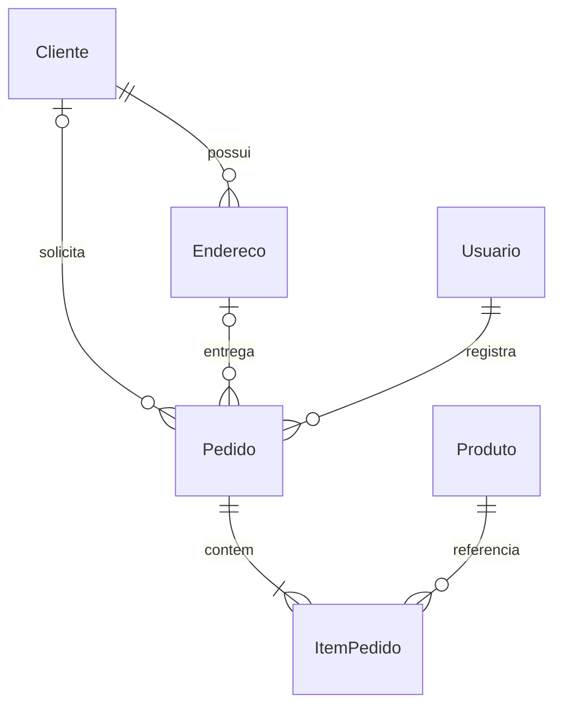

# Modelo de dados

Chaves estrangeiras com exclusão Restrict. Telefones de clientes, e-mails normalizados de usuários e UUIDs de operações possuem índices únicos. Pedido.DataHora tem índice para o filtro dos relatórios. Valores monetários MySQL são decimal(12,2). Produto.Versao protege estoque e alterações concorrentes.

Preço e categoria históricos não dependem do cadastro atual. Taxa e total são calculados no servidor; UsuarioId vem do cookie autenticado. EnderecoId é validado contra ClienteId antes de salvar a entrega.
